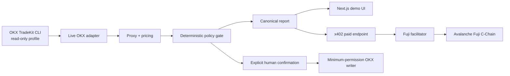

# Hazine Ajanı

**OKX Dual Investment Risk Gate** — canlı OKX verisiyle yapılandırılmış ürün riskini ölçen ve aynı kanonik analizi Avalanche x402 üzerinden başka agentlara satan deterministik karar servisi.

Dual Investment yüksek APR gösterebilir fakat bu oran dönüşüm riskinin karşılığının yeterli olup olmadığını tek başına açıklamaz. Hazine Ajanı, gerçek bir OKX TR `BTC/USDT Buy Low` teklifini canlı OKX opsiyon piyasasındaki işlem yapılabilir fiyat bandıyla karşılaştırır, Simple Earn fırsat maliyetini çıkarır, kullanıcının risk politikasını uygular ve `ACCEPT / ASK / REJECT` sonucu üretir.

## Neyi farklı yapıyor?

- APR sıralamak yerine DCD teklifini gerçek option bid/ask, strike, vade, likidite ve Greeks verisiyle test eder.
- Tek bir “adil değer” iddiası yerine uygulanabilir premium bandını ve eşleşme güvenini gösterir.
- LLM yalnızca politikayı şemaya dönüştürür ve sonucu açıklar. Finansal hesap, güvenlik kararı ve işlem izni deterministik kodda kalır.
- Her OKX write işlemi için ayrı, açık ve tek kullanımlık insan onayı gerekir.
- Aynı analiz başka bir agent tarafından 0.01 Avalanche Fuji **test USDC** ödenerek alınabilir; receipt ve Transfer olayı RPC üzerinden doğrulanır.

## Canlı demo akışı

1. API, OKX TR DCD products, Simple Earn, spot ve option market verisini canlı okur.
2. Proxy motoru en yakın kullanılabilir put kontratını seçer ve veri kalitesi kapılarını uygular.
3. Pricing ve policy paketleri fırsat maliyeti, model olasılığı, stres sonuçları ve reason code'ları üretir.
4. Web arayüzü kaynağı, zaman damgasını, kararı ve sınırları tek ekranda gösterir.
5. Ayrı confirmation state machine yalnız taze `ACCEPT` raporunun write hazırlamasına izin verir.
6. İkinci agent veya MetaMask istemcisi x402 challenge'ını öder ve aynı kanonik raporu Fuji tx kanıtıyla alır.

## Mimari



OKX anahtarı `~/.okx/config.toml` içinde kalır. Tarayıcı, LLM ve Git hiçbir zaman credential görmez. Fuji facilitator anahtarı yalnızca gizli terminal girişinden facilitator sürecine aktarılır. Runtime veya demo kodu mock/fixture import etmez; fixture'lar sadece otomatik testlerde bulunur.

## Gereksinimler

- Node.js `22.20.0`
- pnpm `11.25.0`
- Windows PowerShell
- OKX Agent TradeKit `1.4.8`
- Cloudflare `cloudflared` istemcisi
- Withdrawal izni olmayan read-only OKX TR profili
- Yalnız test varlığı taşıyan Avalanche Fuji cüzdanı

## Kurulum

```powershell
git clone https://github.com/Sahveli01/hazine-ajani.git
Set-Location hazine-ajani
corepack enable
pnpm install --frozen-lockfile
pnpm check
```

`~/.okx/config.toml` içinde `okx-tr-read` adlı read-only profil oluşturun. API key, secret, passphrase veya wallet private key'i `.env`, `.env.example`, komut geçmişi ya da Git'e yazmayın. Değişkenlerin açıklamalı listesi [.env.example](.env.example) dosyasındadır.

## Hackathon boyunca çalıştırma

```powershell
.\scripts\start-hackathon-demo.ps1
```

Komut private key'i ekranda göstermeyen güvenli prompt ile alır; facilitator, canlı OKX API, production Next.js sunucusu ve ücretsiz HTTPS tünelini başlatır. Terminalde yazan `https://…trycloudflare.com` adresi çalışan demo URL'sidir. Bilgisayar ve terminal jüri demosu boyunca açık kalmalıdır. Ayrıntılar [deployment runbook](docs/DEPLOYMENT.md) içindedir.

## Geliştirme ve doğrulama

```powershell
pnpm dev
pnpm lint
pnpm typecheck
pnpm test
pnpm build
pnpm check
```

GitHub Actions her push ve pull request'te kilitli kurulumu ve tam `pnpm check` zincirini çalıştırır.

## Güvenlik sınırları

- İlk OKX profili read-only'dir; write için ayrı minimum izinli profil gerekir.
- Withdrawal izni yasaktır.
- Live execution varsayılan olarak kapalıdır ve server-side tutar limiti vardır.
- Belirsiz write sonucu otomatik yeniden denenmez.
- x402 replay iddiaları kalıcı ve atomik dosya store'unda tutulur.
- DCD ile opsiyon aynı ürün değildir; opsiyon yalnız açık farkları olan benchmark'tır.
- Risk-neutral probability gerçek dünya tahmini değildir.
- Fuji AVAX ve test USDC'nin parasal değeri yoktur.

Tam politika ve bilinen sınırlar [SECURITY.md](SECURITY.md) içindedir.

## Kanıtlar

- Gerçek x402 Fuji settlement: [`0x5887…9d19`](https://testnet.snowtrace.io/tx/0x5887defa349207d091eaa155fb124ec5c0dacd3438b64322401c9e2447439d19)
- Ayrıntılı settlement kaydı: [A5 evidence](outputs/evidence/A5-fuji-x402-settlement.md)
- Güvenlik incelemesi: [E1 review](docs/evidence/e1-financial-security-review-2026-10-16.md)
- Gerçek veri/dead UI denetimi: [Audit 1](docs/evidence/audit-1.md)
- Demo ve Q&A metni: [Demo package](docs/DEMO.md)
- Ürün doğruluk kaynağı: [PROJECT](outputs/PROJECT.md)
- Uygulama ve devir planı: [ROADMAP](outputs/ROADMAP.md)

## Emsaller ve sınır

Anker Protocol, DUAL Finance, Binance Dual Investment Auto-Compound, Volametric, Deribit Position Builder ve önceki ETHGlobal agent projeleri incelendi. Hazine Ajanı bunların bir kopyası değildir: özgün çekirdek, OKX DCD teklifini canlı executable option bandı ve kullanıcının deterministik risk politikasıyla birlikte sınayan, sonucu x402 ile tekrar kullanılabilir servis hâline getiren karar kapısıdır. “World first” iddiası yoktur.

## Resmî kaynaklar

- [OKX Agent TradeKit](https://tr.okx.com/en/agent-tradekit)
- [Agentic Ankara](https://agentic-ankara.vercel.app)
- [Vibe-coding rehberi](https://agentic-ankara.vercel.app/vibe-coding)
- [OKX Dual Investment](https://www.okx.com/help/dual-investment-terms-of-service)
- [Avalanche x402](https://build.avax.network/academy/blockchain/x402-payment-infrastructure/04-x402-on-avalanche/01-why-avalanche)
- [Avalanche Fuji](https://build.avax.network/academy/blockchain/x402-payment-infrastructure/04-x402-on-avalanche/02-network-setup)

## Lisans

[MIT](LICENSE)
